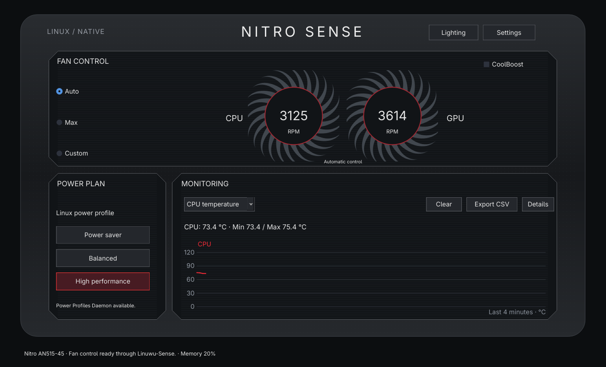

# NitroSense Linux

**Native fan, keyboard lighting and monitoring controls for Acer Nitro AN515-45.**
Built with Qt for Python, reconstructed from the shipped NitroSense 3.1.3056.0
interfaces and layouts, with a reviewed Linuwu-Sense kernel backend.

[Download v0.1.0](https://github.com/Dahuum/nitro-sense-linux/releases/tag/v0.1.0) ·
[Website](https://dahuum.github.io/nitro-sense-linux/) ·
[Installation](docs/installation.md) · [Feature matrix](docs/feature-parity.md) ·
[Report a bug](https://github.com/Dahuum/nitro-sense-linux/issues)



## What works

- **Fan control:** firmware Auto, Max, independent CPU/GPU custom percentages and
  live RPM. Manual control returns to Auto on normal or handled termination.
- **CoolBoost:** read and toggle through the patched driver's APGeAction interface.
- **Keyboard lighting:** static four-zone RGB, individual zone off/color, brightness;
  Breathing, Neon, Wave, Shifting and Zoom with supported speed/direction/color.
- **Monitoring:** CPU temperature/load, discrete NVIDIA temperature/load/VRAM,
  memory use, other Linux hwmon sensors, live history, min/max, clear and CSV export.
- **Power:** actual Linux Power Profiles Daemon profiles; labels and active state
  come from the daemon, not fabricated Windows power-plan equivalents.
- **Device settings:** keyboard backlight timeout, 80% battery limiter, and USB
  charging thresholds when the firmware provides recognized state.
- **Application:** safe local profiles, JSON import/export, C/F units, optional
  system tray, diagnostics, responsive background sensor collection and an
  original native skin. No browser runtime, Wine, telemetry server or account.

**This is an initial Linux release, not a claim of complete Windows pixel and
feature parity.** The main layout follows recovered XAML, while dialogs use native
Qt controls. Acer's DTS/TrueHarmony processing, Windows-only power schemes and
Windows backend are not implemented. RGB commands matched firmware readback;
visible colors/effects still need human confirmation. Read the [precise matrix](docs/feature-parity.md).

## Downloads

| File | Use |
|---|---|
| [Source release](https://github.com/Dahuum/nitro-sense-linux/releases/download/v0.1.0/nitro-sense-linux-0.1.0.tar.gz) | App, driver source, setup/removal scripts, docs and tests |
| [Python wheel](https://github.com/Dahuum/nitro-sense-linux/releases/download/v0.1.0/nitro_sense_linux-0.1.0-py3-none-any.whl) | Install the native application into a Python environment |
| [SHA256SUMS](https://github.com/Dahuum/nitro-sense-linux/releases/download/v0.1.0/SHA256SUMS) | Verify downloaded artifact integrity |

The wheel requires Python 3.10+ and PySide6 6.8+; pip resolves PySide6. It is not
a self-contained AppImage. The source release includes the kernel driver; a
wheel does not install or elevate a driver automatically.

## Install the app

As your normal Linux user:

```sh
git clone https://github.com/Dahuum/nitro-sense-linux.git
cd nitro-sense-linux
python -m venv .venv
.venv/bin/python -m pip install .
.venv/bin/nitro-sense
```

If your distribution already provides PySide6, `python -m venv
--system-site-packages .venv` can reuse it. On Debian/Ubuntu you may also need
`python3-venv`, `libegl1`, `libopengl0`, `libxkbcommon0` and Qt's XCB dependencies.
Use `QT_QPA_PLATFORM=wayland` or `xcb` to match your desktop if auto-detection fails.

To install the release wheel instead, create a venv and run `pip install` on the
wheel file inside it. Add the project's [desktop entry and icon](packaging/) to
your user applications directory if desired, with `Exec` pointing at that venv's
`nitro-sense` executable.

## Install the hardware driver

**Supported write target: Acer Nitro AN515-45.** Hardware testing was performed on
BIOS V1.08 and Linux `6.18.39-1-lts`. Other models remain unvalidated and are
blocked from writes. Read-only telemetry can run without this driver.

Install matching kernel headers, compiler/build tools and kernel module utilities.
On Arch with the LTS kernel this normally means `base-devel linux-lts-headers`.
Use the header package matching your own running kernel.

```sh
# Inspect exact operations first; this does not change anything.
sudo ./scripts/setup-driver.sh --user "$(id -un)" --boot --dry-run

# Build/install source, group permissions, and optional boot startup.
sudo ./scripts/setup-driver.sh --user "$(id -un)" --boot
```

The installer never unloads an active driver. Reboot/log back in so the driver
and `nitrosense` group membership take effect. If there is no competing driver,
a manual load is `sudo modprobe linuwu_sense`. Secure Boot may require signing
the locally built module. Rebuild after a kernel upgrade; no binary built for a
different kernel is shipped. See [full install/removal details](docs/installation.md).

Run the app **as your normal user**, not with sudo. Controls become available
only when recognized and writable. Opening the app or importing a profile never
applies settings; explicit Apply/selection actions do. `nitro-sense --read-only`
turns off changes. `--enable-control` remains accepted for compatibility.

A user-level launcher can also be installed with `./scripts/install-user.sh`;
it creates the environment, menu entry and icon without sudo.

## Optional original artwork

The default project-owned skin works out of the box. Acer logos, artwork, fonts,
installers and decompiled code are not distributed. If you have the exact original
Acer NitroSense 3.1.3056.0 ZIP, import its local artwork without executing Acer code:

```sh
.venv/bin/nitro-sense-import-assets /path/to/Nitro_Sense_Acer_3.01.3056_W11x64_A.zip
```

The importer checks the assembly and resource stream SHA-256 before extracting
only images/fonts into `~/.local/share/nitro-sense/assets`. Use
`NITRO_SENSE_ASSETS=none nitro-sense` to force the bundled native skin, or set the
variable to a directory of locally imported resources. Importer support is pinned
to the artifact hashes in [the evidence identities](evidence/artifact-identities.json).

## Validation on the development laptop

| Operation | Observed result |
|---|---|
| Max fans, eight-second request | CPU 3125 → 5769 RPM; GPU 3703 → 5660 RPM |
| Return to Auto | Six seconds later 3092 / 3703 RPM; cached request `0,0` |
| Custom CPU 60%, GPU 70% | Measured 4615 / 5769 RPM; Auto restored afterward |
| RGB Static/Breathing/Wave | Firmware readback matched modes, colors and brightness; visible output unverified |
| CoolBoost / keyboard timeout | Toggle/readback matched; original values restored |
| Battery limit / USB charging | Toggle/readback matched; original values restored |
| Power profile | Balanced set/readback matched; original performance profile restored |
| Normal-user GUI SIGTERM | Manual60/70 → clean exit0 → Auto0/0, before harness fallback |

[Runtime records](evidence/) distinguish measured RPM, requested percentages,
firmware readback and visual verification. A driver returning success does not
prove all physical effects. Tests are bounded samples on one laptop, not a broad
hardware compatibility guarantee. Both fans were left in automatic mode after
hardware testing. Battery calibration is intentionally excluded from automated
control and tests.

## Fan recovery

Normal window exit and handled SIGINT/SIGTERM request firmware Auto after manual
fan changes. Closing to the tray keeps the app and selected fan mode running.
SIGKILL, kernel failure, removed interfaces and hardware faults cannot be repaired
by a stopped process. To request Auto directly:

```sh
printf '0,0\n' | sudo tee /sys/devices/platform/acer-wmi/nitro_sense/fan_speed
```

See [security/access design](SECURITY.md) and [backend behavior](docs/backend.md).

## Development and reconstruction

```sh
QT_QPA_PLATFORM=offscreen NITRO_SENSE_ASSETS=none \
  python -m unittest discover -s tests -v
QT_QPA_PLATFORM=offscreen NITRO_SENSE_ASSETS=none \
  python -m nitro_sense --smoke-test --screenshot /tmp/nitrosense.png
python -m nitro_sense --diagnose
```

Tests use temporary sysfs fixtures and fake GUI backends; CI never writes laptop
hardware. The buildless landing page is in `website/` and is published by the
GitHub Pages workflow. New source releases are built with `python -m build`.

- [Protocol reconstruction](docs/protocol-evidence.md)
- [Original UI/resource evidence](docs/ui-evidence.md)
- [Hardware investigation](docs/hardware-support.md)
- [Feature parity and remaining differences](docs/feature-parity.md)
- [Public REA record identity index](evidence/public-summary.json)
- [Contributing](CONTRIBUTING.md) and [license notices](THIRD_PARTY_NOTICES.md)

REA static analysis, ILSpy and Ghidra established artifact, CIL, layout and native
service facts. Raw vendor metadata, original C#/XAML and complete decompilation
records remain local; only bounded protocol findings, identity hashes, runtime
measurements and project-owned screenshots are published.

The application and website are MIT licensed. The modified Linuwu-Sense driver
retains its upstream GPL license. This is independent software, not an Acer product.
